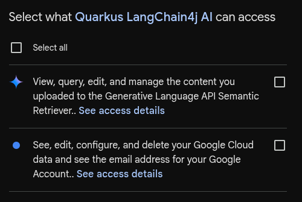

# Secure Vertex AI Gemini Poem Demo

This secure poem demo showcases how users authenticated with Google can request a poem from a Vertex AI Gemini model.

## The Demo

Demo asks Vertex AI Gemini LLM to write a short 1-paragraph poem, using the access token acquired during the OIDC authorization code flow with the Google OpenId Connect provider.

### OpenId Connect authentication

This demo requires users to authenticate with Google.

#### Google authentication

You have to register an application with Google, follow steps listed in the [Quarkus Google](https://quarkus.io/guides/security-openid-connect-providers#google) section.

Name your Google application as `Quarkus LangChain4j AI`, and make sure an allowed callback URL is set to `http://localhost:8080/model/vertex-gemini`.
Google will generate a client id and secret, use them to set `quarkus.oidc.vertex-gemini.client-id` and `quarkus.oidc.vertex-gemini.credentials.secret` properties.
Set `GOOGLE_PROJECT_ID` to the id of your Google Cloud project.
You must also enable Vertex AI API in your Google Cloud project.

```properties
# Named 'vertex-gemini' Google OIDC provider
quarkus.oidc.vertex-gemini.provider=google
quarkus.oidc.vertex-gemini.client-id=${GOOGLE_CLIENT_ID}
quarkus.oidc.vertex-gemini.credentials.secret=${GOOGLE_CLIENT_SECRET}
quarkus.oidc.vertex-gemini.authentication.extra-params.scope=https://www.googleapis.com/auth/generative-language.retriever,https://www.googleapis.com/auth/cloud-platform
quarkus.oidc.vertex-gemini.authentication.redirect-path=/model/vertex-gemini
```

### Vertex AI Gemini

Vertex AI Gemini is configured as follows:

```properties
# Vertex AI Gemini model is accessed after a user has authenticated with Google.
# See https://cloud.google.com/vertex-ai/docs/geeral/locations
vertex-ai-region=europe-west2

quarkus.langchain4j.vertexai.gemini.location=${vertex-ai-region}
quarkus.langchain4j.vertexai.gemini.project-id=${GOOGLE_PROJECT_ID}
quarkus.langchain4j.vertexai.gemini.chat-model.model-id=gemini-3.5-flash
quarkus.langchain4j.vertexai.gemini.log-requests=true
quarkus.langchain4j.vertexai.gemini.log-responses=true
```

## Security Considerations

This demo makes it possible to access Google Vertex Gemini models only to users who have authenticated with Google and authorized the registered `Quarkus LangChain4j AI` application to access these models on behalf of the currently authenticated user.

Users authorize `Quarkus LangChain4j AI` application registered in the Google Cloud project to use the access token to access Google Generative API on behalf of the currently authenticated user. This authorization is requested from users during the authentication process and is configured by adding additional `quarkus.oidc.vertex-gemini.authentication.extra-params.scope=https://www.googleapis.com/auth/generative-language.retriever,https://www.googleapis.com/auth/cloud-platform` scopes in the application properties.
* Quarkus LangChain4j vertex-ai-gemini model provider uses this authorized token on behalf of the current user to access Google Vertex AI endpoint.

### Who enforces the scope

The model provider enforces the scope, not Quarkus. The application accesses the model on behalf of the user by forwarding the user's access token to the model provider that enforces the scope and rejects the call when the token lacks the required scope.
The application relies on the `quarkus-langchain4j-oidc-model-auth-provider` extension to propagate the current access token to the model provider.

Google shows each requested scope as a separate checkbox on its consent screen. The first one below is the `generative-language.retriever` scope and the second one is `cloud-platform`; both start unchecked and the user has to select them:



If a user does not approve the `cloud-platform` scope, Vertex AI answers with `403 PERMISSION_DENIED` and the reason `ACCESS_TOKEN_SCOPE_INSUFFICIENT`. `PoemResource` passes the provider's HTTP status through with a `@ServerExceptionMapper`, and the page explains that access was not granted and offers to sign in again, instead of showing a server error.

## Running the Demo

To run the demo, set the Google variables to your values and use the following commands:

```shell
export GOOGLE_CLIENT_ID=<your-google-client-id>
export GOOGLE_CLIENT_SECRET=<your-google-client-secret>
export GOOGLE_PROJECT_ID=<your-google-cloud-project-id>

mvn quarkus:dev
```

Access `http://localhost:8080`, login to Quarkus PoemResource with Google, and follow a provided application link to read the poem.
Use the logout link to log out and try again, for example after approving or declining the requested scopes.

## Using Microsoft Entra ID and Azure OpenAI

The demo can also let users authenticated with Microsoft Entra ID request a poem from an Azure OpenAI model. This requires registering Entra ID and Azure OpenAI resources, which is why the demo does not enable it by default.

### Entra ID and Azure OpenAI setup

Please follow [Get started with Azure OpenAI service](https://learn.microsoft.com/en-us/azure/ai-services/openai/overview#get-started-with-azure-openai-service) guide, note that you must complete a Limited Access Registration Form first before you can start creating Azure OpenAI service resources.

Once an approval to work with Azure OpenAI service is given, create your first Azure OpenAI resource such as `quarkus-langchain4j`.
Use Azure OpenAI Studio to create a deployment, by selecting one of the base models such as `gpt-4o-mini`, note the API version of selected model.

Go to `Access Control (IAM)` in the `quarkus-langchain4j` resource dashboard, choose `Role Assignments`, add `Azure AI Developer` to yourself (or try one of the Cognitive Data Service roles). Repeat for all other users which are allowed to access the resource.

Next, register an Azure Entra ID OIDC application.

Name your Azure Entra ID application as `Quarkus LangChain4j AI`, and make sure an allowed callback URL is set to `http://localhost:8080/model/azure-openai`.
Entra ID will generate a client id and secret, use them to set `quarkus.oidc.azure-openai.client-id` and `quarkus.oidc.azure-openai.credentials.secret` properties. Also note a tenant id.

Finally, go to `API Permissions` in the registered `Quarkus LangChain4j AI` application dashboard.
Select `Add Permission`, next select `APIs My Orgnaization uses` and choose `Microsoft Cognitive Services` and enable its `user_impersonation` option.

### Entra ID and Azure OpenAI configuration

Add the Azure OpenAI extension to `pom.xml`:

```xml
<dependency>
    <groupId>io.quarkiverse.langchain4j</groupId>
    <artifactId>quarkus-langchain4j-azure-openai</artifactId>
    <version>${quarkus-langchain4j.version}</version>
</dependency>
```

Add the Entra ID OIDC provider and the Azure OpenAI model to `application.properties`.
When more than one model is used, you must use `quarkus.langchain4j.chat-model.provider` to name the default model's provider, and the Azure OpenAI model is configured using an `openai` named configuration:

```properties
# Named 'azure-openai' Microsoft Entra ID OIDC provider
quarkus.oidc.azure-openai.auth-server-url=https://login.microsoftonline.com/${AZURE_TENANT_ID}/v2.0
quarkus.oidc.azure-openai.application-type=web-app
quarkus.oidc.azure-openai.client-id=${AZURE_CLIENT_ID}
quarkus.oidc.azure-openai.credentials.secret=${AZURE_CLIENT_SECRET}
quarkus.oidc.azure-openai.authentication.scopes=profile,https://cognitiveservices.azure.com/.default
quarkus.oidc.azure-openai.authentication.redirect-path=/model/azure-openai
quarkus.oidc.azure-openai.token.principal-claim=name

# Vertex AI Gemini stays the default model
quarkus.langchain4j.chat-model.provider=vertexai-gemini

# Named Azure OpenAI model is accessed after a user has authenticated with Entra ID.
quarkus.langchain4j.openai.chat-model.provider=azure-openai
quarkus.langchain4j.azure-openai.openai.resource-name=${AZURE_OPENAI_RESOURCE}
quarkus.langchain4j.azure-openai.openai.deployment-name=${AZURE_OPENAI_DEPLOYMENT}
quarkus.langchain4j.azure-openai.openai.api-version=${AZURE_OPENAI_DEPLOYMENT_API_VERSION}
quarkus.langchain4j.azure-openai.openai.log-requests=true
quarkus.langchain4j.azure-openai.openai.log-responses=true
```

Add a second AI service and endpoint to `PoemResource`:

```java
@RegisterAiService(modelName = "openai", tools = PoemTools.class)
public interface AzureOpenAiPoemService {
    @UserMessage(USER_MESSAGE)
    String writePoem();
}

@Inject
AzureOpenAiPoemService azureOpenAI;

@GET
@Path("azure-openai")
public String getPoemAzureOpenAI() {
    return azureOpenAI.writePoem();
}
```

Then link to `/model/azure-openai` from `index.html` and set the `AZURE_*` variables before running the demo. The page texts in this demo only mention Google, so adjust them for Azure OpenAI.

Users authorize `Quarkus LangChain4j AI` application registered in the Azure Entra ID dashboard to use the access token to access Azure OpenAI Generative API on behalf of the currently authenticated user. This authorization is requested from users during the authentication process and is configured with the `quarkus.oidc.azure-openai.authentication.scopes=profile,https://cognitiveservices.azure.com/.default` scopes in the application properties.
